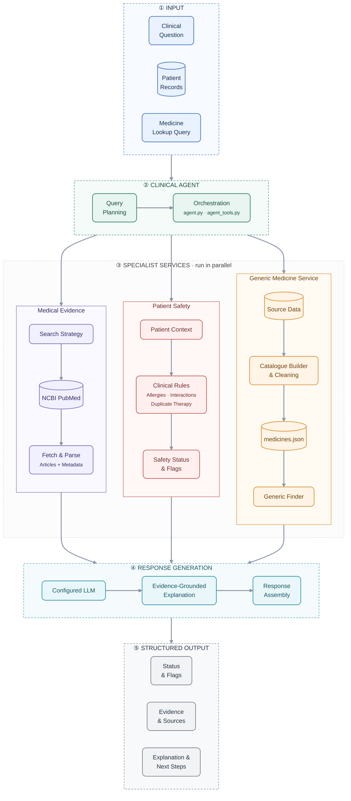
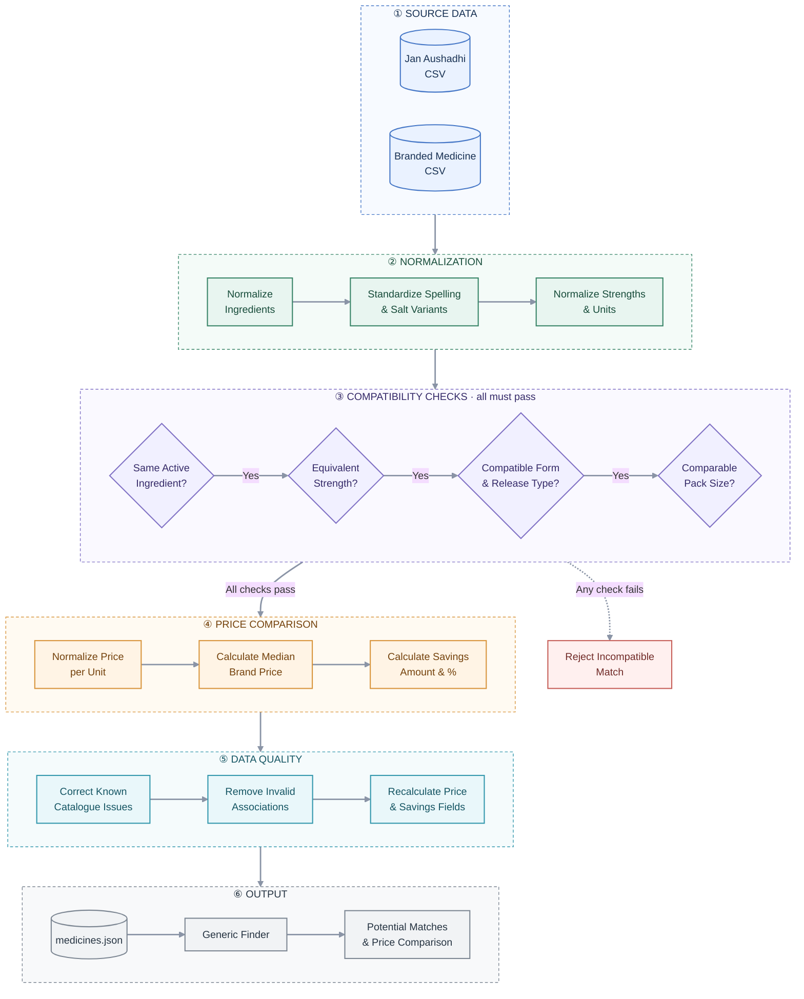

# MedPerplexity
### A Clinical Decision-Support Agent Powered by Medical Evidence

MedPerplexity is a Python-based AI agent prototype that combines **clinical query planning, PubMed literature retrieval, patient-specific safety checks, and generic medicine discovery** in a single command-line workflow.

Instead of relying entirely on a language model to answer medical questions, MedPerplexity combines retrieved medical literature with deterministic safety rules and structured response validation. Its objective is to demonstrate how an AI agent can retrieve evidence, consider available patient context, surface potential risks, and communicate uncertainty in a reviewable format.

> **Disclaimer:** MedPerplexity is an experimental research and educational prototype. It is not clinically validated and must not be used as the sole basis for diagnosis, prescribing, or medication changes. All clinical decisions require independent verification by a qualified healthcare professional.

---

## Table of Contents

- [Overview](#overview)
- [Key Features](#key-features)
- [System Architecture](#system-architecture)
- [Medicine Data Preprocessing Pipeline](#medicine-data-preprocessing-pipeline)
- [Technology Stack](#technology-stack)
- [Getting Started](#getting-started)
- [Usage](#usage)
- [Understanding the Response](#understanding-the-response)
- [Patient Data](#patient-data)
- [Project Structure](#project-structure)
- [Testing](#testing)
- [Limitations](#limitations)
- [Future Scope](#future-scope)
- [License](#license)

---

## Overview

Medical decision support requires more than generating a plausible answer. A useful system must retrieve relevant information, consider available patient context, identify potential safety concerns, and distinguish retrieved evidence from assumptions.

MedPerplexity explores this problem through a modular agent architecture.

### Key Features

- **Clinical query processing:** Accepts natural-language medical questions and prepares inputs for the available tools.
- **Medical literature retrieval:** Searches PubMed through NCBI Entrez and retrieves article metadata, abstracts where available, and source references.
- **Patient-specific safety checks:** Evaluates recorded allergies, selected cross-reactivity concerns, duplicate therapy, and configured drug-interaction patterns.
- **Evidence-aware responses:** Includes source information and retrieval-level indicators to help users assess the basis of an answer.
- **LLM provider fallback:** Supports configurable language-model providers, depending on available credentials and configuration.
- **Generic medicine discovery:** Searches a local Jan Aushadhi-derived medicine catalogue for potential generic matches and price comparisons.
- **Data preprocessing:** Normalizes medicine information and checks ingredient, strength, formulation, and pack-size compatibility before comparable price calculations.
- **Structured output:** Returns JSON containing status, explanation, sources, safety flags, and suggested next steps.
- **Research export:** Supports exporting selected PubMed search results to Excel.
- **Developer integration:** Exposes tool specifications and a structured response contract for integration with other applications.

---

## System Architecture

MedPerplexity separates clinical request handling, evidence retrieval, safety validation, language-model response generation, and generic medicine discovery into distinct components.



### How the workflow operates

1. **Input and context:** The user submits a clinical question and may provide a patient ID.
2. **Query planning:** The agent determines the request intent and prepares relevant inputs for its tools.
3. **Evidence retrieval:** The PubMed integration searches for relevant articles and retrieves their metadata and available abstracts.
4. **Safety evaluation:** The deterministic rule layer evaluates the available patient information and recognized medicines against configured safety checks.
5. **Response generation:** The configured LLM helps explain the retrieved findings and available tool results.
6. **Response assembly:** The agent combines relevant information, validates the response structure and source references, and incorporates safety status.
7. **Output:** The CLI returns structured JSON with the response, sources, evidence-level signal, and safety flags.

The generic medicine finder is a separate capability. It uses the processed local catalogue when a medicine lookup is requested or relevant.

### Design principle

**The language model is not the only safety mechanism.** Deterministic checks operate separately from generated prose, while retrieved sources provide supporting context.

However, configured rules cover only selected cases. An absent warning does not establish that a medicine is safe, and retrieving a paper does not prove that its findings apply to an individual patient.

---

## Medicine Data Preprocessing Pipeline

One of the important engineering components of MedPerplexity is its medicine-catalogue preprocessing workflow.

Medicine catalogues often contain inconsistent spellings, different units, varying pack sizes, and product descriptions that are difficult to compare directly. Comparing prices using product-name similarity alone can produce misleading results.

The active catalogue-building pipeline uses **deterministic normalization and compatibility checks** to make the matching and price-comparison process more consistent and explainable.




### 1. Source data

The pipeline starts with the available medicine datasets, including the Jan Aushadhi catalogue and branded medicine data.

These source files are not assumed to be perfectly consistent.

### 2. Normalization

The pipeline standardizes medicine information so that equivalent representations can be compared.

Examples include:

- Normalizing active ingredient names.
- Handling recognized spelling and salt-name variants.
- Converting equivalent strength units, such as `500 mcg` and `0.5 mg`, to a common representation.

Normalization reduces superficial differences but does not, by itself, establish that two products are interchangeable.

### 3. Compatibility matching

The active builder checks clinically relevant product attributes before comparing prices:

- Active ingredient.
- Strength.
- Dosage form.
- Release type, where applicable.
- Comparable pack quantity.

A matching ingredient name alone is not sufficient to establish compatibility.

### 4. Price comparison

Price values are normalized to comparable quantities. The pipeline uses matched brand-price information to calculate a median brand price per unit and derives savings amounts and percentages.

This helps avoid comparisons between products with different pack quantities.

### 5. Data cleaning

The cleaning stage addresses known source-data issues, inappropriate product associations, and inconsistent price or savings fields.

### 6. Catalogue generation

The processed records are stored in `data/medicines.json`, which is used by the generic finder for subsequent lookups.

### What about semantic embeddings?

The repository retains an earlier S-PubMedBert embedding-based candidate-matching experiment under `scripts/legacy/`.

That approach used semantic representations to identify potential matches before validation. It is important to distinguish that experiment from the active catalogue builder, which uses deterministic matching constraints.

The current approach prioritizes explicit compatibility checks and reproducibility for price comparisons rather than relying on semantic similarity alone.

To rebuild the catalogue:

```bash
python -m medperplexity build
```

Refer to [`data/README.md`](data/README.md) for the source schema, matching constraints, and data limitations.

---

## Technology Stack

| Component | Technology |
|---|---|
| Programming language | Python |
| Agent workflow | LangGraph-compatible agent implementation |
| LLM providers | OpenRouter, with optional Anthropic, OpenAI, and Gemini providers |
| Medical literature | NCBI Entrez / PubMed, Biopython |
| Data processing | Pandas |
| Excel export | OpenPyXL |
| Catalogue matching | Deterministic normalization and matching |
| Optional fuzzy matching | RapidFuzz |
| Testing | Python `unittest` |
| Configuration | Environment variables and `.env` |

Provider availability and model identifiers depend on the installed dependencies and environment configuration.

---

## Getting Started

### Prerequisites

- Python 3.9 or newer.
- Internet access for live PubMed retrieval and configured LLM providers.
- An NCBI contact email for Entrez requests.
- An API key for the configured LLM provider if AI-generated explanations are required.

The rule-based planning and selected local catalogue operations can run without an LLM. Live evidence retrieval still requires network access.

### 1. Clone the repository

```bash
git clone <your-repository-url>
cd medperplexity
```

### 2. Create a virtual environment

```bash
python -m venv .venv
```

Activate it in Windows PowerShell:

```powershell
.venv\Scripts\Activate.ps1
```

On macOS or Linux:

```bash
source .venv/bin/activate
```

### 3. Install dependencies

Install the project and optional fast fuzzy matching:

```bash
python -m pip install --upgrade pip
pip install -e ".[fast]"
```

If you need the optional agent-framework dependencies:

```bash
pip install -e ".[agents]"
```

### 4. Configure environment variables

Copy the example configuration file.

Windows PowerShell:

```powershell
Copy-Item .env.example .env
```

macOS or Linux:

```bash
cp .env.example .env
```

Set your NCBI contact email:

```dotenv
NCBI_EMAIL=you@example.com
```

For LLM-generated explanations, configure the provider you want to use. For example:

```dotenv
LLM_PROVIDERS=openrouter,anthropic,openai,gemini
OPENROUTER_API_KEY=your_key_here
OPENROUTER_MODEL=your_model_id
```

Configure only providers you intend to use. Provider fallback depends on valid credentials and supported model settings.

**Never commit API keys, secrets, or real patient records.**

### 5. Check the LLM configuration

```bash
python -m medperplexity llm-check
```

Use model identifiers supported by your provider. Availability and model names can change over time.

---

## Usage

Commands are executed from the repository root. Most CLI operations return JSON output.

### 1. Ask a clinical question

Use the synthetic sample patient dataset:

```bash
python -m medperplexity ask PAT-007 "Prescribe Potassium chloride supplement" --patients data/patients.sample.json
```

This example demonstrates a configured medication-interaction warning path. It is not a treatment recommendation.

To include audit information:

```bash
python -m medperplexity ask PAT-007 "Prescribe Potassium chloride supplement" --patients data/patients.sample.json --audit
```

Passing the patient file explicitly makes the example reproducible.

### 2. Search PubMed

```bash
python -m medperplexity pubmed "Can I prescribe clopidogrel with omeprazole?"
```

Limit the number of results:

```bash
python -m medperplexity pubmed "metformin vitamin B12 deficiency" --retmax 10
```

### 3. Find a generic medicine

```bash
python -m medperplexity generic "Atorlip 10"
```

Specify a local catalogue and result limit:

```bash
python -m medperplexity generic "Atorlip 10" --db data/medicines.json --limit 5
```

The result is based on the bundled catalogue. It does not represent live pharmacy stock or a guaranteed current retail price, and a potential match is not authorization to substitute a medicine.

### 4. Export PubMed results to Excel

```bash
python -m medperplexity export \
  --authors "Anthony Fauci" \
  --topics RNA cardiovascular \
  --start 2012/03/01 \
  --end 2022/12/31 \
  --retmax 20 \
  --out results.xlsx
```

Adjust the author, topics, dates, and output path as required.

### 5. Inspect tool specifications

```bash
python -m medperplexity specs --style openai
```

### 6. Call an agent tool directly

```bash
python -m medperplexity call search_medical_evidence "{\"drugs\":[\"clopidogrel\",\"omeprazole\"],\"intent\":\"interaction\"}"
```

### 7. Explore available CLI commands

```bash
python -m medperplexity --help
python -m medperplexity clean --help
python -m medperplexity build --help
python -m medperplexity llm-check
```

---

## Understanding the Response

The `ask` command returns a structured JSON response. Fields can vary depending on the query, patient context, safety checks, and evidence returned.

### Illustrative response

```json
{
  "status": "caution",
  "title": "Review the evidence before prescribing",
  "message": "A concise explanation of the findings and relevant safety concerns.",
  "suggestion": "Checks or follow-up steps for a clinician to consider.",
  "sources": [
    {
      "pmid": "38665148",
      "title": "Example article title",
      "url": "https://pubmed.ncbi.nlm.nih.gov/38665148/"
    }
  ],
  "pmids": ["38665148"],
  "evidence_level": "indirect",
  "flags": [
    {
      "type": "example_safety_flag",
      "severity": "caution",
      "drug": "Example medicine",
      "detail": "Explanation of the rule that was triggered."
    }
  ],
  "disclaimer": "Decision support only. A clinician or pharmacist must verify before any prescribing decision."
}
```

This is an illustrative schema, not a guaranteed response for every query.

### Status interpretation

| Status | Meaning |
|---|---|
| `blocked` | A configured high-severity rule identified a concern that prevents the request from being presented as acceptable. |
| `caution` | A safety concern exists, the evidence is indirect or weak, or additional verification is needed. |
| `info` | An informational note or missing-data condition is being surfaced without a higher-severity alert. |
| `approved` | No blocking concern was identified under the implemented checks and internal response conditions. This is not clinical clearance. |

The most severe applicable status from the configured rule checks and model response is used when assembling the final result.

### Evidence-level interpretation

The prototype uses retrieval-process labels:

- `direct` — results were returned without broadening the search strategy.
- `indirect` — results were found after the search strategy was broadened.
- `none` — the search returned no usable results.
- `unavailable` — the evidence service could not be used successfully.

These labels describe the retrieval process. They are **not a formal evidence-quality grading system**, and they do not independently establish clinical relevance.

---

## Patient Data

The repository includes `data/patients.sample.json` for demonstration and testing. It contains synthetic patient records.

The patient rule layer recognizes common field variants for allergies, current medications, and conditions.

| Information | Example field names |
|---|---|
| Allergies | `allergies`, `allergy`, `drug_allergies`, `known_allergies` |
| Current medications | `current_medications`, `medications`, `current_meds`, `meds`, `current_medication` |
| Conditions | `condition_tags`, `conditions`, `diagnoses`, `problems` |

Allergy information can be represented as a list, a comma-separated string, or objects containing a name-like field.

An absent allergy field is different from an explicitly empty allergy list. Missing information can trigger a warning that allergies are not recorded.

**Use synthetic data for demonstrations and tests.** Before using real patient data, appropriate consent, access control, encryption, retention, and provider-specific privacy arrangements must be established.

---

## Project Structure

```text
medperplexity/
├── src/
│   └── medperplexity/
│       ├── agent.py
│       ├── agent_tools.py
│       ├── clinical_rules.py
│       ├── patients.py
│       ├── llm.py
│       ├── pubmed.py
│       ├── pubmed_export.py
│       ├── generic_finder.py
│       ├── build_database.py
│       ├── data_cleaning.py
│       ├── config.py
│       └── cli.py
├── data/
│   ├── medicines.json
│   ├── jan_aushadhi.csv
│   ├── patients.sample.json
│   └── README.md
├── docs/
│   ├── AGENT_BACKEND.md
│   └── AGENT_INTEGRATION.md
├── examples/
│   ├── agent_integration/
│   ├── entrez_walkthrough/
│   └── sample_output/
├── scripts/
│   └── legacy/
├── tests/
├── .env.example
├── pyproject.toml
├── requirements.txt
└── README.md
```

### Important modules

| Module | Responsibility |
|---|---|
| `agent.py` | Agent workflow and response assembly. |
| `agent_tools.py` | Tool definitions, schemas, and dispatch. |
| `clinical_rules.py` | Deterministic patient and medication safety checks. |
| `patients.py` | Patient record loading and context preparation. |
| `llm.py` | Provider configuration, fallback, and response validation. |
| `pubmed.py` | PubMed search and article parsing. |
| `generic_finder.py` | Generic medicine lookup and price comparison. |
| `build_database.py` | Medicine catalogue construction and matching. |
| `data_cleaning.py` | Catalogue cleanup and price-field consistency. |
| `pubmed_export.py` | PubMed result export to Excel. |
| `config.py` | Environment and path configuration. |
| `cli.py` | Command-line interface. |

---

## Testing

Run the test suite from the repository root:

```bash
python -m unittest discover -s tests -v
```

The project uses `unittest` and mocks external-service responses for many provider and retrieval paths.

A passing test suite demonstrates that tested software paths behave as expected. It does **not** establish clinical safety, validate every interaction rule, or guarantee the quality of live PubMed results and LLM responses.

For a basic smoke test:

1. Configure `.env`.
2. Run `python -m medperplexity llm-check`.
3. Execute a clinical query using the synthetic patient file.
4. Inspect the status, safety flags, source links, and explanation.

---

## Limitations

MedPerplexity is a prototype and has important limitations:

- **Not clinically validated:** No prospective clinical evaluation or clinician-led validation is claimed.
- **Incomplete safety knowledge:** The rule tables cover selected cases and are not a comprehensive drug-interaction database.
- **Evidence relevance varies:** Retrieved articles may be indirect or poorly matched to the patient's circumstances.
- **LLM output can be wrong:** Response validation and source filtering cannot eliminate hallucinations or incorrect interpretation.
- **Catalogue limitations:** Generic matches and prices depend on the bundled data snapshot, not live inventory.
- **Substitution requires professional review:** Ingredient, strength, formulation, release type, pack size, patient factors, and local regulations matter.
- **External services can fail:** PubMed and LLM providers may be unavailable, rate-limited, or change their interfaces.
- **Privacy and deployment hardening:** The prototype is not a production-grade clinical information system.

---

## Future Scope

The current objective is to build a functional AI agent that combines evidence retrieval, patient context, deterministic safety checks, and structured responses. Future work could improve how the system understands medical terminology and connects drug relationships to supporting research.

### 1. Clinical NLP and Entity Normalization

Develop a clinical NLP component to identify medicines, strengths, conditions, contraindications, and interaction intent from natural-language queries. Normalize extracted entities to consistent clinical concepts to reduce ambiguity.

### 2. Drug-Interaction Knowledge Graph

Represent medicines, drug classes, mechanisms, adverse effects, medical conditions, and research papers as connected entities with explicit relationship types and provenance.

### 3. Graph-Assisted Evidence Retrieval

Use extracted clinical entities and graph relationships to construct focused PubMed queries and prioritize literature based on drug match, interaction type, clinical context, and study design.

### 4. Graph Neural Network Experiments

Explore graph neural networks to learn representations of drug relationships and prioritize candidate interactions or relevant evidence. This would require curated datasets, suitable labels, external validation, and careful evaluation.

### 5. Clinical Evaluation

Develop realistic test scenarios and evaluate missed safety alerts, false-positive alerts, evidence relevance, and response consistency. Seek qualified clinical review before considering any higher-stakes deployment.

These are proposed future directions, not implemented capabilities. Learned predictions should remain distinguishable from verified clinical facts and should not independently approve or block a prescription.

---

## Acknowledgements

MedPerplexity builds on NCBI Entrez/PubMed and the Biopython ecosystem. Refer to the project documentation and bundled data notes for details about the medicine catalogue and its source-data limitations.
