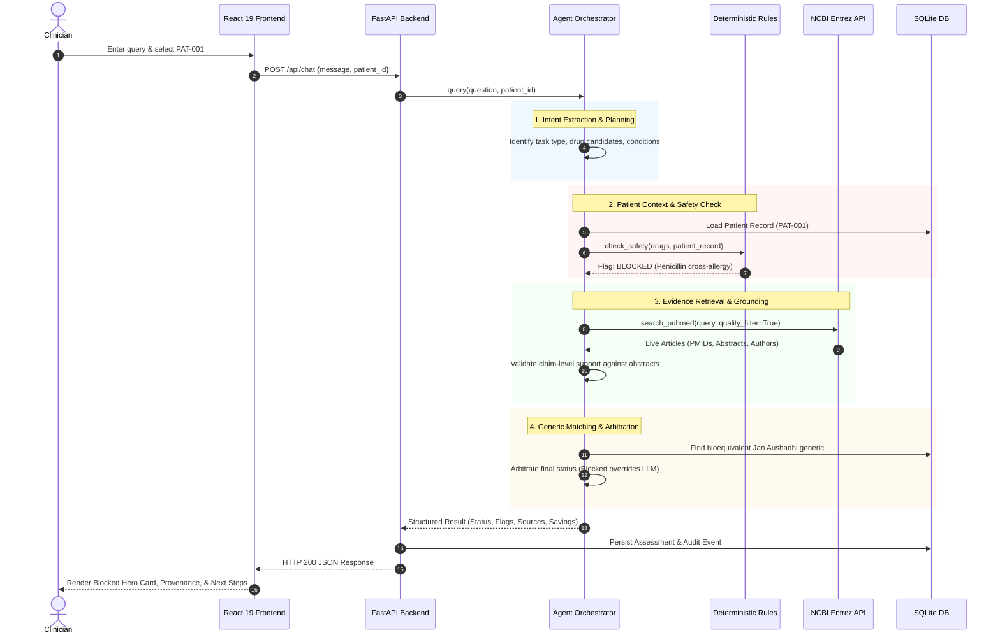
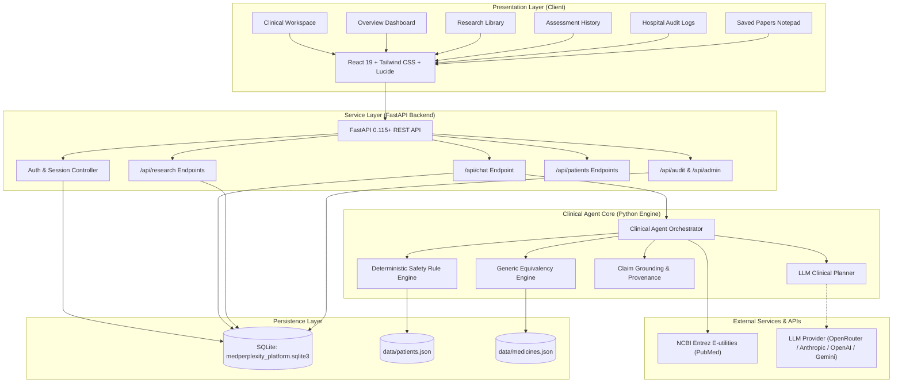

# MedPerplexity

<p align="center">
  
</p>

<p align="center">
  <strong>Evidence-Grounded Clinical Decision Support Platform with Deterministic Safety Verification</strong>
</p>

<p align="center">
  <a href="#clinical-problem-and-architectural-approach"></a>
  <a href="#medical-evidence-retrieval-and-claim-validation"></a>
  <a href="#data-preprocessing-and-generic-medicine-catalogue"></a>
  <a href="#testing-and-evaluation"></a>
  <a href="#technology-stack-and-package-description"></a>
  <a href="#license-and-provenance"></a>
</p>

---

## Executive Summary

**MedPerplexity** is an evidence-grounded clinical intelligence and prescription verification platform. It couples large language model (LLM) clinical planning with **hard deterministic clinical safety rules**, **live biomedical literature retrieval via NCBI Entrez (PubMed)**, **claim-level evidence validation**, a **normalized generic medicine catalogue**, and an **auditable full-stack clinical workspace**.

Generative language models operating alone present unacceptable risks in clinical workflows: they hallucinate biomedical citations, invent dosing regimens, and miss subtle contraindications. MedPerplexity enforces an architectural boundary: **language models plan queries and synthesize human-readable summaries, but deterministic clinical rules and verified PubMed citations adjudicate clinical safety.**

> [!WARNING]
> **RESEARCH & EDUCATIONAL PROTOTYPE — NOT CLINICALLY VALIDATED**
> MedPerplexity is an experimental clinical decision-support system built for architectural research and educational demonstration. It is **not** a certified medical device, has not received regulatory clearance (e.g., FDA 510(k), CE mark), and **must not be used as the sole basis for clinical diagnosis, prescribing, dosage alteration, or patient care**. All clinical conclusions require independent assessment by a licensed healthcare professional.

---

## Table of Contents

- [1. Clinical Problem and Architectural Approach](#1-clinical-problem-and-architectural-approach)
- [2. Platform Capabilities and User Experience](#2-platform-capabilities-and-user-experience)
- [3. End-to-End Clinical Request Lifecycle](#3-end-to-end-clinical-request-lifecycle)
- [4. System Architecture](#4-system-architecture)
- [5. Data Preprocessing and Generic Medicine Catalogue](#5-data-preprocessing-and-generic-medicine-catalogue)
- [6. Medical Evidence Retrieval and Claim Validation](#6-medical-evidence-retrieval-and-claim-validation)
- [7. Clinical Safety Rules and Patient Context](#7-clinical-safety-rules-and-patient-context)
- [8. Technology Stack and Package Description](#8-technology-stack-and-package-description)
- [9. Repository Structure and Module Responsibilities](#9-repository-structure-and-module-responsibilities)
- [10. Prerequisites and Step-by-Step Installation](#10-prerequisites-and-step-by-step-installation)
- [11. Configuration and Environment Reference](#11-configuration-and-environment-reference)
- [12. Command Reference (CLI & Backend)](#12-command-reference-cli--backend)
- [13. REST API Specification and Contracts](#13-rest-api-specification-and-contracts)
- [14. Testing, Evaluation, and CI Verification](#14-testing-evaluation-and-ci-verification)
- [15. Security, Privacy, and Clinical Limitations](#15-security-privacy-and-clinical-limitations)
- [16. Operational Troubleshooting](#16-operational-troubleshooting)
- [17. Future Scope and Roadmap](#17-future-scope-and-roadmap)
- [18. License and Provenance](#18-license-and-provenance)

---

## 1. Clinical Problem and Architectural Approach

### The Problem with Pure Generative LLMs in Healthcare

1. **Fabricated Citations & Hallucinations:** Commercial LLMs frequently invent realistic PubMed IDs (PMIDs), non-existent journal titles, and fabricated author lists to justify clinical assertions.
2. **Silent Failure in Allergy & Contraindication Checks:** Statistical next-token predictors can overlook negative constraints, such as prescribing amoxicillin to a patient with a documented severe penicillin allergy or co-prescribing ACE inhibitors with potassium sparing agents.
3. **Black-Box Reasoning:** Clinicians cannot independently audit why a probabilistic model approved or warned against a therapy without verifiable provenance.
4. **Economic Blind Spots:** Prescribers frequently lack immediate visibility into bioequivalent, affordable generic alternatives at the point of care.

### The MedPerplexity Hybrid Solution

MedPerplexity addresses these vulnerabilities by separating probabilistic reasoning from deterministic safety verification:

```
[ Natural Language Query ]
            │
            ▼
┌───────────────────────────────┐
│     LLM Clinical Planner      │ ── Extracts intent, drugs, conditions, patient ID
└───────────────────────────────┘
            │
            ├──► Deterministic Safety Engine ──► Evaluates allergies, cross-reactivities,
            │                                    duplicate therapies, drug interactions
            │
            ├──► NCBI Entrez PubMed Client   ──► Fetches live PMIDs, titles, abstracts
            │                                    and validates claim-level support
            │
            └──► Generic Medicine Catalogue  ──► Matches equivalent salts, forms, strengths,
                                                 and computes price savings
            │
            ▼
┌───────────────────────────────┐
│  Arbitration & Status Engine  │ ── Deterministic safety overrides probabilistic LLM
└───────────────────────────────┘
            │
            ▼
[ Auditable Clinical Output ]
```

- **Safety Overrides:** If a deterministic rule flags a life-threatening allergy or major drug interaction, the overall order status is immediately clamped to `blocked` or `caution`, regardless of what the generative LLM generated.
- **Strict Evidence Grounding:** All biomedical literature citations are fetched live from the National Center for Biotechnology Information (NCBI) Entrez API. Unsubstantiated claims are explicitly flagged during claim validation.
- **Read-Only Patient Record Isolation:** Medical record queries operate deterministically on structured patient records, preventing the LLM from inventing historical laboratory values or diagnoses.

---

## 2. Platform Capabilities and User Experience

MedPerplexity provides a complete hospital-grade web platform and an autonomous Python engine.

### 2.1 Hospital Clinician Sign-In & Enterprise Roles

MedPerplexity implements secure clinician authentication with PBKDF2 password hashing, session tokens, and department isolation.

<p align="center">
  
</p>

*Figure 1: Hospital Clinician Sign-In modal supporting credentialed access and pre-seeded demonstration profiles (Cardiology, Neurology, Internal Medicine, and Hospital Administration).*

---

### 2.2 Clinical Workspace & Prescription Decision Support

The **Clinical Workspace** is the central diagnostic console. It integrates a live patient selector, starter clinical templates (Allergy Review, Drug Interaction, Guideline Literature, Generic Savings), an interactive query composer, and real-time structured clinical outputs.

<p align="center">
  
</p>

*Figure 2: Clinical Workspace in light mode. An order for Amoxicillin for patient Rahul Sharma (PAT-001) is immediately stopped by the deterministic safety engine due to a documented penicillin allergy.*

---

### 2.3 Executive Clinical Intelligence Dashboard

The **Clinical Intelligence Overview Dashboard** provides departmental analytics, active patient metrics, curated cardiology literature alerts, and recent clinical assessment streams.

<p align="center">
  
</p>

*Figure 3: Departmental Overview dashboard in light theme displaying attending physician details, patient census, research stream, and recent activity.*

<p align="center">
  
</p>

*Figure 4: Clinical Intelligence Overview dashboard in dark mode, designed with low-glare charcoal surfaces, calibrated semantic alerts, and high-contrast clinical typography.*

---

### 2.4 Independent Biomedical Research Library & Paper Modal

Clinicians can explore PubMed literature directly without requiring an active patient encounter. The **Research Library** features specialty-specific filters (Cardiology, Oncology, Neurology, Endocrinology, Infectious Disease), real-time search, and deep inspection modals.

<p align="center">
  
</p>

*Figure 5: Research Library interface displaying live PubMed articles retrieved for Cardiology.*

<p align="center">
  
</p>

*Figure 6: Paper Detail Inspection modal featuring structured abstract, publication metadata, DOI link, and a persistent clinical annotation notepad.*

---

### 2.5 Curated Reference Collection (Saved Papers)

Clinicians can bookmark relevant literature to their personal research collection, attach private clinical notes, and manage references for clinical rounds.

<p align="center">
  
</p>

*Figure 7: Curated Saved Papers view organizing bookmarked citations, clinician notes, and direct NCBI Entrez links.*

---

### 2.6 Clinical Assessment History & Audit Details

Every order submitted across the hospital is immutably recorded with its full reasoning trace, safety flags, retrieved citations, and user timestamp.

<p align="center">
  
</p>

*Figure 8: Assessment History log displaying historical queries, patient identifiers, risk levels, and inspection triggers.*

<p align="center">
  
</p>

*Figure 9: Assessment Detail Audit modal displaying the exact clinical query, safety flags, verified citations, and clinician suggestion for a previous consultation.*

---

### 2.7 Hospital Governance, Audit Trails & Clinician Profile

The platform provides administrative audit logs and clinician profile customization (specialty focus, credentials, light/dark theme preference).

<p align="center">
  
</p>

*Figure 10: Hospital Audit Log stream displaying chronological, tamper-resistant system events across authentication, query executions, and database writes.*

<p align="center">
  
</p>

*Figure 11: Clinician Profile & Settings interface for managing organization details, primary specialty focus, and theme switches.*

---

## 3. End-to-End Clinical Request Lifecycle

When a clinician executes a query (e.g., *"Prescribe Amoxicillin 500mg TDS for patient PAT-001"*), MedPerplexity executes the following deterministic lifecycle:



### Detailed Lifecycle Phases

1. **Intake & Context Binding:** The request binds the active user session with the selected patient context (`PAT-001`).
2. **Clinical Planning:** The LLM clinical planner extracts candidate medications, dosage indications, and clinical questions. If the question is purely a patient record summary, literature search is bypassed.
3. **Deterministic Safety Evaluation:** The clinical rule engine checks candidate drugs against the patient's documented allergies, active medications, and chronic conditions. Cross-reactivities (e.g., penicillins vs. cephalosporins) and known high-risk pairs (e.g., ACEI + Potassium, NSAID + Anticoagulant) are evaluated.
4. **Biomedical Literature Retrieval:** If literature retrieval is indicated, PubMed is queried via NCBI Entrez with clinical filters (systematic reviews, meta-analyses, randomized controlled trials).
5. **Claim-Level Grounding:** Extracted medical claims are verified against retrieved abstracts. Claims lacking verbatim quotation support are classified as unverified.
6. **Generic Catalogue Discovery:** The generic engine matches requested brand-name drugs with bioequivalent formulations in the Jan Aushadhi database, computing price differences.
7. **Status Arbitration:** The final status is determined by strict hierarchy:
   - `blocked`: Active severe allergy or lethal contraindication.
   - `caution`: Clinically significant interaction, renal dose caution, or partial evidence.
   - `info`: Record summary or literature review without adverse interactions.
   - `approved`: Clinically sound therapy verified by literature and clear of safety flags.
8. **Audit Logging & Persistence:** The assessment and structured audit trails are saved in SQLite (`medperplexity_platform.sqlite3`).
9. **UI Presentation:** The frontend renders the status card, evidence citations, safety flags, and clinician recommendations.

---

## 4. System Architecture

MedPerplexity is built as a modular system with clear architectural separation between presentation, application orchestration, clinical rules, and storage.



### Architectural Subsystems

| Subsystem | Primary Implementation | Responsibilities |
| :--- | :--- | :--- |
| **Frontend UI** | React 19, TypeScript, Tailwind CSS 3.4, Vite 6 | Provides clinical screens, keyboard navigation, theme switching, and real-time state management. |
| **Backend API** | FastAPI, Pydantic v2, Uvicorn | Exposes REST endpoints, validates schemas, enforces session security, and coordinates agent workflows. |
| **Agent Orchestrator** | `medperplexity.agent`, `medperplexity.agent_tools` | Dispatches tools, executes clinical planning, aggregates literature and safety flags, and arbitrates final status. |
| **Clinical Safety Engine** | `medperplexity.clinical_rules` | Pure deterministic evaluation of drug-drug interactions, allergy cross-reactivities, duplicate therapies, and missing records. |
| **Biomedical Literature Engine** | `medperplexity.pubmed` | Communicates with NCBI Entrez (ESearch/EFetch), applies clinical publication filters, parses XML, and scores claim provenance. |
| **Generic Medicine Engine** | `medperplexity.build_database`, `data_cleaning` | Normalizes multi-ingredient pharmaceutical formulations, enforces compatibility constraints, and calculates price savings. |
| **Persistence Store** | SQLite 3 (WAL mode) via `backend.app.db` | Persists user credentials, clinical assessments, hospital audit logs, saved papers, and cached catalogues. |

---

## 5. Data Preprocessing and Generic Medicine Catalogue

MedPerplexity incorporates a reproducible pharmaceutical data pipeline that cleans, standardizes, and cross-references government-subsidized generic medicines (Pradhan Mantri Bhartiya Janaushadhi Pariyojana - PMBJP) against branded commercial formulations.

<p align="center">
  
  
  
</p>

### Preprocessing Architecture

The preprocessing pipeline converts heterogeneous source datasets into a high-performance, indexed JSON catalogue:

```
[ jan_aushadhi.csv ] (PMBJP Generics)  ───┐
                                          ├──► [ clean_data.py ] ──► [ clean_jan_aushadhi.csv ] ──┐
[ brand_medicines.csv ] (Market Brands) ──┘                                                      ├──► [ build_database.py ] ──► data/medicines.json
                                                                                                 │
                                          └──► [ clean_brand_medicines.csv ] ────────────────────┘
```

### 1. Data Cleaning & Unit Standardization (`src/medperplexity/data_cleaning.py`)

- **Ingredient Splitting:** Complex multi-drug combination strings (e.g., `"Amoxicillin 500mg + Potassium Clavulanate 125mg"`) are tokenized into constituent chemical entities.
- **Strength Normalization:** Strengths are normalized to uniform metric units (`mg`, `mcg`, `g`, `iu`, `% w/w`, `% w/v`).
- **Dosage Form Normalization:** Formulations are mapped into canonical clinical forms:
  `tablet`, `capsule`, `injection`, `syrup`, `suspension`, `drops`, `ointment`, `cream`, `inhaler`, `gel`, `powder`.
- **Release Profile Extraction:** Release modifiers are identified and separated:
  `immediate-release`, `sustained-release (SR)`, `extended-release (ER)`, `controlled-release (CR)`, `enteric-coated (EC)`.

### 2. Equivalency Matching Rules (`src/medperplexity/build_database.py`)

To ensure patient safety, a generic medicine is linked to a branded drug **only if all five clinical compatibility criteria are satisfied**:

1. **Active Pharmaceutical Ingredient (API) Match:** Complete set equivalence of all active molecules.
2. **Strength Equivalence:** Identical dosage strengths per active molecule.
3. **Dosage Form Concordance:** Must share identical route and presentation (e.g., a capsule cannot substitute for an oral suspension).
4. **Release Characteristic Match:** Immediate release cannot substitute for extended-release formulations.
5. **Pack Size Ratio Boundary:** Pack sizes must not exceed a 4:1 ratio (`MAX_PACK_RATIO = 4.0`) to prevent gross quantity mismatches.

### 3. Price Comparison & Median Economics

- **Price-Per-Unit Normalization:**
  $$\text{Price Per Unit} = \frac{\text{Total Pack Price}}{\text{Pack Size}}$$
- **Outlier-Resistant Savings:** The baseline price for a branded medicine is calculated using the **median unit price** across all matching branded formulations in the database, protecting savings estimates against price distortions:
  $$\text{Savings Percentage} = \frac{\text{Median Brand Unit Price} - \text{Generic Unit Price}}{\text{Median Brand Unit Price}} \times 100$$

### Executing the Catalogue Build Pipeline

```bash
# 1. Clean raw source CSVs
python -m medperplexity clean

# 2. Build the linked JSON database
python -m medperplexity build
```

---

## 6. Medical Evidence Retrieval and Claim Validation

MedPerplexity retrieves biomedical evidence directly from NCBI Entrez (PubMed) using parameterized clinical search strategies.

<p align="center">
  
</p>

*Figure 12: Evidence panel displaying verified safety flags alongside claim-level quotation support scores (1/3 supported vs PMID 40645375).*

<p align="center">
  
</p>

*Figure 13: Live PubMed citation card with publication year, PMID, abstract preview, and collapsible agent execution audit trail.*

### Retrieval Pipeline Mechanics

1. **Query Formulation & Keyword Optimization:** Clinical questions are transformed into biomedical search queries. Medical stop words and conversational phrases are removed.
2. **Clinical Quality Filtering:** When enabled (`quality_filter=True`), searches append evidence-focused publication limits:
   ```text
   AND (guideline[pt] OR practice guideline[pt] OR consensus development conference[pt] 
        OR systematic review[pt] OR meta-analysis[pt] OR randomized controlled trial[pt])
   ```
3. **Resilient NCBI Communication:** E-utilities requests (`esearch.fcgi`, `efetch.fcgi`) use exponential backoff, rate limiting (up to 10 requests/sec with registered API keys), and strict timeout handling.
4. **Structured XML Extraction:** Returned PubMed XML is parsed into canonical metadata: Title, Authors, Journal, Year, Volume, Issue, Abstract, DOI, and PMID.

### Claim-Level Provenance & Grounding Verification

To prevent ungrounded assertions from reaching clinicians, MedPerplexity evaluates generated claims against retrieved abstracts:

- Claims are split into atomic clinical assertions.
- Each claim is verified against source abstract text using exact and fuzzy n-gram matching.
- **Evidence Output Metric:** The system outputs an explicit claim-support metric (e.g., `1 of 3 claims supported by retrieved literature`). Unsubstantiated claims are marked with a cautionary provenance badge.

---

## 7. Clinical Safety Rules and Patient Context

Deterministic rules are executed locally in Python without relying on external network calls or probabilistic LLM inference.

<p align="center">
  
</p>

*Figure 14: Deterministic safety block displaying the contraindication mechanism and recommending safe therapeutic alternatives.*

### Implemented Deterministic Safety Categories

#### 1. Allergy & Cross-Reactivity Verification
- **Exact Drug Matching:** Direct matches against patient-documented allergy records.
- **Cephalosporin-Penicillin Cross-Reactivity:** Flags 1st and 2nd generation cephalosporins in patients with confirmed severe penicillin anaphylaxis due to shared $\beta$-lactam ring structures.

#### 2. High-Risk Drug-Drug Interaction Rules
- **Potassium-Sparing / RAAS Combinations:** Co-prescription of ACE Inhibitors / ARBs (e.g., Enalapril, Ramipril, Losartan) with Potassium supplements or potassium-sparing diuretics (e.g., Spironolactone) triggers a hyperkalemia warning.
- **Anticoagulant & Antiplatelet Hemorrhage Risk:** Co-prescription of Anticoagulants (e.g., Warfarin, Apixaban) with NSAIDs (e.g., Ibuprofen, Diclofenac) triggers a gastrointestinal bleeding contraindication.
- **Tetracycline & Retinoid Interaction:** Co-prescription of Tetracyclines (e.g., Doxycycline) with oral Retinoids (e.g., Isotretinoin) triggers an intracranial hypertension (pseudotumor cerebri) block.
- **Macrolide & Statin Interaction:** Co-prescription of CYP3A4-inhibiting Macrolides (e.g., Clarithromycin, Erythromycin) with Statins (e.g., Atorvastatin, Simvastatin) triggers a rhabdomyolysis / myopathy alert.

#### 3. Duplicate Therapy Detection
- Detects simultaneous prescription of multiple drugs within the same therapeutic class (e.g., co-prescribing two distinct NSAIDs or two distinct ARBs).

#### 4. Patient Record Query Grounding
- Dedicated read-only summary mode: When a clinician requests an allergy, condition, or medication summary, the system draws solely from verified EHR fields, returning status `info` and explicitly noting unrecorded data points without triggering false medication warnings.

### Clinical Status Classification

| Status Level | Trigger Condition | Visual Indicator | Clinician Guidance |
| :--- | :--- | :--- | :--- |
| **`blocked`** | Confirmed drug allergy, severe cross-reactivity, or lethal combination. | **Red Alert Banner** | Immediate cessation; therapy must not be administered. Alternative suggested. |
| **`caution`** | Clinically relevant interaction, partial evidence, or required lab monitoring. | **Amber Warning** | Proceed only with close monitoring (e.g., serum electrolytes, renal function). |
| **`info`** | Record summary, guideline lookup, or general inquiry with no contraindications. | **Blue Information** | Educational and observational context; no immediate safety hazards detected. |
| **`approved`** | Regimen evaluated against patient record with no adverse flags and PubMed support. | **Green Checkmark** | Prescription aligns with patient safety constraints and verified literature. |

---

## 8. Technology Stack and Package Description

### Technology Stack Overview

| Layer | Technologies & Frameworks |
| :--- | :--- |
| **Frontend Framework** | React 19.0.0, TypeScript 5.6.3, Vite 6.0.5 |
| **Styling & UI Components** | Tailwind CSS 3.4.16, PostCSS, Lucide React 0.468, Radix UI Slot |
| **Backend API** | FastAPI 0.115.6, Starlette 0.41.3, Uvicorn 0.34.0 |
| **Data Validation & Parsing** | Pydantic 2.10.4, Pydantic-Settings, Email-Validator 2.2.0 |
| **Biomedical Integration** | NCBI Entrez E-utilities (REST/XML), HTTPX 0.28.1 |
| **AI / LLM Orchestration** | Multi-Provider Engine (OpenRouter, Anthropic, OpenAI, Google Gemini) |
| **Storage & Persistence** | SQLite 3 (WAL mode), JSON Document Stores |
| **Office & Data Export** | Pandas 2.2.3, OpenPyXL 3.1.5 |
| **Testing & Quality** | Python Unittest, Vite Test Suite |

### Python Package Specification (`pyproject.toml`)

MedPerplexity is packaged as a modular, standards-compliant Python library (`medperplexity v0.1.0`):

- **Build System:** `setuptools>=61.0`, `wheel`
- **CLI Entrypoint:** `medperplexity = medperplexity.cli:main`
- **Core Dependencies:** `httpx>=0.24.0`, `pydantic>=2.0.0`, `pydantic-settings>=2.0.0`
- **Optional Feature Extras:**
  - `[fast]`: High-performance HTTP and XML parsers (`lxml>=4.9.0`, `orjson>=3.9.0`).
  - `[agents]`: Advanced clinical LLM connectors (`google-genai>=0.1.0`, `openai>=1.0.0`, `anthropic>=0.18.0`).
  - `[backend]`: Full hospital server dependencies (`fastapi>=0.110.0`, `uvicorn>=0.28.0`, `python-multipart>=0.0.9`, `email-validator>=2.0.0`).
  - `[test]`: Complete test runners and mock suites (`pytest>=7.0.0`, `pytest-asyncio>=0.21.0`, `pytest-cov>=4.0.0`).
  - `[all]`: Complete installation bundle across all categories.

---

## 9. Repository Structure and Module Responsibilities

```
medperplexity/
├── backend/                             # FastAPI Hospital Platform Service
│   └── app/
│       ├── __init__.py
│       ├── main.py                      # FastAPI application, route declarations, CORS & error handling
│       ├── db.py                        # SQLite persistence, PBKDF2 hashing, schema & migrations
│       └── models.py                    # Pydantic request/response transfer models
│
├── frontend/                            # React 19 Hospital Web Application
│   ├── src/
│   │   ├── components/
│   │   │   ├── ClinicalWorkspaceView.tsx  # Central 3-column clinical decision console
│   │   │   ├── OverviewDashboardView.tsx  # Attending physician metrics & department overview
│   │   │   ├── ResearchLibraryView.tsx    # Specialty-filtered biomedical literature browser
│   │   │   ├── SavedPapersView.tsx        # Curated reference collection & private clinical notepad
│   │   │   ├── AssessmentHistoryView.tsx  # Patient assessment history table & audit modals
│   │   │   ├── AuditLogsView.tsx          # Enterprise tamper-resistant audit event stream
│   │   │   ├── SettingsView.tsx           # Hospital preferences, credentials & theme selection
│   │   │   └── LoginModal.tsx             # Clinician authentication modal & demo user selector
│   │   ├── App.tsx                      # Main shell, layout state, navigation & theme controller
│   │   ├── styles.css                   # Tailwind design system tokens (light/dark calibrated)
│   │   └── main.tsx                     # React application entry point
│   ├── index.html                       # HTML application template
│   ├── package.json                     # Frontend dependencies & build scripts
│   ├── tailwind.config.js               # Theme color extensions & typography definitions
│   └── vite.config.ts                   # Vite bundler configuration & local proxy
│
├── src/
│   └── medperplexity/                  # Core Clinical Decision-Support Package
│       ├── __init__.py                  # Package exports and version metadata
│       ├── agent.py                     # Agent orchestrator, query routing & clinical arbitration
│       ├── agent_tools.py               # Tool contracts, parameter schemas & tool execution wrappers
│       ├── clinical_rules.py            # Pure deterministic drug safety, allergy & interaction engine
│       ├── pubmed.py                    # NCBI Entrez client, quality filtering & XML parser
│       ├── patients.py                  # Patient record store, key normalization & EHR abstraction
│       ├── build_database.py            # Generic medicine linkage & price comparison builder
│       ├── data_cleaning.py             # Pharmaceutical strength/form normalization pipeline
│       ├── export.py                    # Excel and structured research exporter
│       ├── llm.py                       # Multi-provider LLM gateway (OpenRouter, Anthropic, OpenAI)
│       ├── models.py                    # Pydantic schemas for clinical outputs, flags & literature
│       └── cli.py                       # Command-line interface subcommands and formatting
│
├── data/                                # Local Data Persistence
│   ├── patients.json                    # Synthetic EHR records (PAT-001 through PAT-005)
│   ├── medicines.json                   # Processed Jan Aushadhi generic catalogue
│   ├── brand_medicines.csv              # Raw commercial pharmaceutical source data
│   └── jan_aushadhi.csv                 # Raw PMBJP generic pharmaceutical source data
│
├── static/                              # Platform Visual Artifacts & Documentation Figures
│   ├── Screenshot 2026-10-29 004655.png  # Landing page hero
│   ├── Screenshot 2026-10-29 003111.png  # Clinical workspace (Light mode)
│   ├── Screenshot 2026-10-29 003856.png  # Overview dashboard (Light mode)
│   ├── Screenshot 2026-10-29 003948.png  # Overview dashboard (Dark mode)
│   ├── ...                              # Complete 15 screenshot documentation suite
│
├── tests/                               # Comprehensive Automated Test Suite (233 Tests)
│   ├── test_agent.py                    # Agent orchestration and fallback tests
│   ├── test_backend_api.py              # FastAPI endpoints, auth, sessions & audit logging tests
│   ├── test_clinical_rules.py           # Deterministic interaction & cross-reactivity safety tests
│   ├── test_record_summary.py           # Read-only EHR summary routing & missing data tests
│   ├── test_pubmed.py                   # NCBI Entrez client, mocking, and XML parsing tests
│   ├── test_patients.py                 # Patient store retrieval & validation tests
│   └── test_build_database.py           # Medicine catalogue cleaning & matching tests
│
├── .env.example                         # Master configuration and API credentials template
├── pyproject.toml                       # Standards-compliant Python package metadata
├── requirements.txt                     # Root dependency manifest
└── README.md                            # Complete engineering and architectural documentation
```

---

## 10. Prerequisites and Step-by-Step Installation

### System Prerequisites

- **Python:** 3.10 or higher
- **Node.js:** 18.0.0 or higher (LTS recommended)
- **Package Managers:** `pip` (Python) and `npm` (Node.js)
- **Operating Systems:** Windows 10/11, macOS (Apple Silicon & Intel), or Linux (Ubuntu 22.04+)

---

### Step-by-Step Setup Guide

#### Step 1: Clone Repository & Create Virtual Environment

##### Windows (PowerShell):
```powershell
# Clone the repository
git clone https://github.com/your-org/medperplexity.git
cd medperplexity

# Create Python virtual environment
python -m venv venv

# Activate virtual environment
.\venv\Scripts\Activate.ps1
```

##### macOS / Linux (Bash):
```bash
# Clone the repository
git clone https://github.com/your-org/medperplexity.git
cd medperplexity

# Create Python virtual environment
python3 -m venv venv

# Activate virtual environment
source venv/bin/activate
```

---

#### Step 2: Install Python Package Dependencies

```bash
# Upgrade build tools
python -m pip install --upgrade pip setuptools wheel

# Install core package in editable mode with backend and test extras
pip install -e ".[backend,test,fast]"

# Alternatively, install via requirements.txt
pip install -r requirements.txt
```

---

#### Step 3: Install Frontend Dependencies

```bash
# Navigate to frontend and install node packages
cd frontend
npm install
cd ..
```

---

#### Step 4: Configure Environment Variables

Create your local `.env` configuration file from the template:

```bash
# Copy example configuration
cp .env.example .env
```

Open `.env` and configure your credentials:
```ini
# NCBI Entrez Configuration (PubMed)
# Required by NCBI policy: https://www.ncbi.nlm.nih.gov/books/NBK25497/
NCBI_EMAIL=dr.sharma@metrohealth.org
NCBI_API_KEY=your_ncbi_api_key_here

# LLM Provider Configuration (Optional - System uses deterministic fallbacks if omitted)
LLM_PROVIDER=openrouter
OPENROUTER_API_KEY=your_openrouter_api_key_here
OPENROUTER_MODEL=anthropic/claude-3.5-sonnet

# Database File Paths
PATIENTS_DB=data/patients.json
MEDPERPLEXITY_DB=data/medicines.json
```

---

#### Step 5: Start the MedPerplexity Platform

You can run the full-stack system concurrently in two terminal tabs:

##### Terminal 1: Backend API Service
```bash
# From workspace root
uvicorn backend.app.main:app --host 0.0.0.0 --port 8000 --reload
```
*The FastAPI backend will initialize the SQLite database (`backend/medperplexity_platform.sqlite3`) and start listening at `http://localhost:8000`.*

##### Terminal 2: React 19 Frontend Dev Server
```bash
# Navigate to frontend directory
cd frontend
npm run dev
```
*Vite will compile the frontend and start the application server at `http://localhost:5173`.*

---

## 11. Configuration and Environment Reference

All settings are managed via environment variables or `.env` files.

| Variable Name | Required | Default Value | Clinical & Technical Purpose |
| :--- | :---: | :--- | :--- |
| `NCBI_EMAIL` | **Yes** | *None* | Email identifier transmitted in User-Agent header to comply with NCBI Entrez API guidelines. |
| `NCBI_API_KEY` | Recommended | *None* | Increases NCBI Entrez rate limits from 3 requests/sec to 10 requests/sec. |
| `LLM_PROVIDER` | No | `openrouter` | Specifies primary LLM gateway (`openrouter`, `anthropic`, `openai`, `gemini`, or `none`). |
| `OPENROUTER_API_KEY` | Conditional | *None* | Authentication token for OpenRouter multi-model gateway. |
| `OPENROUTER_MODEL` | No | `anthropic/claude-3.5-sonnet` | Target model identifier for clinical reasoning and planning. |
| `ANTHROPIC_API_KEY` | Conditional | *None* | Direct API key for native Anthropic Claude models. |
| `OPENAI_API_KEY` | Conditional | *None* | Direct API key for OpenAI GPT models. |
| `GOOGLE_API_KEY` | Conditional | *None* | Direct API key for Google Gemini models. |
| `PATIENTS_DB` | No | `data/patients.json` | Relative path to local structured patient records database. |
| `MEDPERPLEXITY_DB` | No | `data/medicines.json` | Relative path to cleaned Jan Aushadhi generic catalogue. |
| `DATABASE_PATH` | No | `backend/medperplexity_platform.sqlite3` | SQLite database storing hospital users, sessions, and audit events. |
| `LOG_LEVEL` | No | `INFO` | Application logging verbosity (`DEBUG`, `INFO`, `WARNING`, `ERROR`). |

---

## 12. Command Reference (CLI & Backend)

The `medperplexity` package provides an autonomous command-line interface for head-less clinical queries, database compilation, and research export.

### 1. Execute a Clinical Query (`ask`)

Runs the full clinical agent workflow against a patient record directly in the terminal:

```bash
# Prescribe Amoxicillin for patient PAT-001 (Evaluates penicillin allergy)
python -m medperplexity ask "Prescribe Amoxicillin 500mg TDS for patient PAT-001" --patient PAT-001

# Run an interaction check between Losartan and Potassium
python -m medperplexity ask "Can I co-prescribe Losartan and Potassium Chloride?" --patient PAT-002 --json
```

### 2. Search Biomedical Literature (`pubmed`)

Performs a targeted NCBI Entrez PubMed search with optional clinical publication filters:

```bash
# Search for SGLT2 inhibitor trials in heart failure
python -m medperplexity pubmed "SGLT2 inhibitors heart failure" --limit 5 --quality

# Retrieve specific article details by PMID
python -m medperplexity pubmed --pmid 38295697
```

### 3. Find Generic Medicine Equivalents (`generic`)

Queries the local Jan Aushadhi catalogue for bioequivalent generics and price comparisons:

```bash
# Search for generic substitutes for Augmentin 625 Duo
python -m medperplexity generic "Augmentin 625 Duo"
```

### 4. Rebuild Generic Medicine Database (`build` & `clean`)

Executes the data cleaning and compatibility pipeline:

```bash
# Step 1: Clean raw CSVs
python -m medperplexity clean

# Step 2: Build matched medicines.json database
python -m medperplexity build
```

### 5. Export Literature to Excel (`export`)

Exports PubMed search results to a formatted Excel workbook with citations and abstract summaries:

```bash
python -m medperplexity export "GLP-1 receptor agonists kidney disease" --output research_export.xlsx
```

### 6. Verify LLM Provider Connectivity (`llm-check`)

Tests connection and latency to configured LLM inference providers:

```bash
python -m medperplexity llm-check
```

---

## 13. REST API Specification and Contracts

The FastAPI backend exposes a secure, validated JSON API.

### 1. Authentication & Session Management

- `POST /api/auth/login`
  - **Body:** `{"email": "dr.sharma@metrohealth.org", "password": "password123"}`
  - **Response (200 OK):**
    ```json
    {
      "token": "tok-a8f9c1e7b4d2",
      "user": {
        "id": "USR-001",
        "email": "dr.sharma@metrohealth.org",
        "name": "Dr. Priya Sharma, MD",
        "role": "doctor",
        "department": "Cardiology",
        "organization_id": "ORG-001"
      }
    }
    ```
- `GET /api/auth/me` — Returns active session user profile.
- `POST /api/auth/logout` — Revokes active session token.

### 2. Clinical Decision Support (`/api/chat`)

- `POST /api/chat`
  - **Body:**
    ```json
    {
      "message": "Prescribe Amoxicillin 500mg TDS for patient PAT-001",
      "patient_id": "PAT-001",
      "session_id": "conv-mvrqypzn"
    }
    ```
  - **Response (200 OK):**
    ```json
    {
      "id": "ASM-81512",
      "status": "blocked",
      "title": "BLOCKED: allergy",
      "message": "Amoxicillin is blocked: Patient has a documented allergy to Penicillin (cross-reactive class: Penicillin).",
      "clinician_suggestion": "Select an alternative antibiotic class such as a macrolide, fluoroquinolone, or consult infectious disease.",
      "safety_flags": [
        {
          "severity": "blocked",
          "category": "allergy",
          "message": "Patient has a documented allergy to Penicillin.",
          "drug": "Amoxicillin"
        }
      ],
      "sources": [
        {
          "pmid": "40645375",
          "title": "Cross-reactivity and safety of beta-lactam alternatives in penicillin-allergic patients",
          "journal": "J Allergy Clin Immunol",
          "year": "2024",
          "authors": ["Martinez A", "Chen Y", "Gomez R"],
          "doi": "10.1016/j.jaci.2024.01.012"
        }
      ],
      "claims_supported": 1,
      "claims_total": 3,
      "generic_savings": null,
      "audit_trail": {
        "execution_time_ms": 412,
        "tools_invoked": ["patient_record", "clinical_rules", "pubmed"]
      }
    }
    ```

### 3. Patient EHR Directory (`/api/patients`)

- `GET /api/patients` — List all patients in active clinic census.
- `GET /api/patients/{patient_id}` — Retrieve full EHR profile (demographics, active medications, documented allergies, chronic conditions, and recent vitals).

### 4. Biomedical Literature Library (`/api/research`)

- `GET /api/research?specialty=Cardiology&limit=15` — Retrieve live literature stream by specialty.
- `GET /api/research/saved` — List clinician's bookmarked papers with notes.
- `POST /api/research/saved` — Save a paper with custom notes:
  ```json
  {
    "pmid": "38295697",
    "title": "SGLT2 inhibitors and cardiorenal outcomes",
    "journal": "Lancet",
    "year": "2024",
    "authors": ["Heerspink HJL", "et al."],
    "notes": "Relevant for Monday morning grand rounds discussion."
  }
  ```
- `DELETE /api/research/saved/{pmid}` — Remove paper from saved collection.

### 5. Audit Logging & Governance (`/api/audit`)

- `GET /api/audit?limit=50` — Query hospital tamper-resistant audit logs.
- `GET /api/assessments` — Query past clinical assessments.
- `GET /api/admin/metrics` — Departmental usage, safety block frequency, and clinical activity.

---

## 14. Testing, Evaluation, and CI Verification

MedPerplexity includes an automated test suite comprising **233 unit, integration, and platform tests**.

<p align="center">
  
  
  
</p>

### Test Suite Structure

```
tests/
├── test_agent.py             # Agent query routing, tool dispatch, and LLM fallback logic
├── test_backend_api.py       # FastAPI endpoints, auth, sessions, CORS, and database operations
├── test_clinical_rules.py    # Deterministic drug safety, cross-reactivity, and interaction logic
├── test_record_summary.py    # Dedicated EHR record summary routing & missing data grounding
├── test_pubmed.py            # NCBI Entrez client, XML deserialization, and mock resilience
├── test_patients.py          # Patient record store indexing and key normalization
└── test_build_database.py    # Medicine normalization, pack-ratio rules, and median calculations
```

### Running the Test Suite Locally

```bash
# Run the complete test suite with verbose output
python -m unittest discover -s tests -v

# Run backend API integration tests
python -m unittest tests/test_backend_api.py -v

# Run deterministic clinical safety tests
python -m unittest tests/test_clinical_rules.py -v

# Run record summary workflow verification
python -m unittest tests/test_record_summary.py -v
```

### Frontend Build Verification

The React 19 frontend compiles under strict TypeScript type-checking:

```bash
cd frontend
npm run build
```

---

## 15. Security, Privacy, and Clinical Limitations

### Security & Privacy Protections

1. **Synthetic Patient Data Exclusively:** The repository ships solely with synthetic test records (`PAT-001` through `PAT-005`). No real Protected Health Information (PHI) or Personally Identifiable Information (PII) is included or retained.
2. **Deterministic Credential Encryption:** Hospital user passwords are encrypted using PBKDF2 with SHA-256 and unique cryptographic salts (`backend/app/db.py`).
3. **No External Transmission of Patient Identifiers:** Patient names and identifying demographics are stripped before external literature searches; queries transmit only normalized drug molecules and clinical condition terms to NCBI Entrez.
4. **Environment Isolation:** Secrets and API keys are strictly loaded via `.env` and are excluded from version control via `.gitignore`.

### Clinical System Limitations

- **Non-Exhaustive Pharmacopeia:** The deterministic rules engine contains curated rules for common, high-mortality drug pairs (RAAS + Potassium, Anticoagulants + NSAIDs, Retinoids + Tetracyclines, Statins + Macrolides). It is **not** an exhaustive replacement for comprehensive commercial drug interaction databases (such as First Databank or Lexicomp).
- **Abstract Availability:** NCBI PubMed returns abstracts only when publishers make them publicly accessible; full-text articles behind paywalls cannot be ingested.
- **Geographic Generic Formulary:** The generic catalogue is derived from India's PMBJP (Jan Aushadhi) database and may not reflect pharmaceutical brand availability or pricing structures in other jurisdictions.

---

## 16. Operational Troubleshooting

| Symptom | Probable Cause | Corrective Action |
| :--- | :--- | :--- |
| **`NCBI_EMAIL not configured`** | Missing email in `.env` | Add `NCBI_EMAIL=your_email@example.com` to `.env` as required by NCBI API policy. |
| **`SQLite OperationalError: database is locked`** | Concurrent processes accessing SQLite file without WAL mode | Verify WAL mode is active: backend initializes `PRAGMA journal_mode=WAL;`. Avoid running manual test runners concurrently. |
| **`ModuleNotFoundError: No module named 'fastapi'`** | Running tests without backend dependencies installed | Run `pip install -e ".[backend,test]"` or `pip install -r requirements.txt`. |
| **`LLM API Timeout or Connection Refused`** | Invalid API key or upstream outage | The system automatically falls back to deterministic rule synthesis. Check API keys in `.env` or set `LLM_PROVIDER=none`. |
| **Frontend `Network Error` on `/api/*`** | Backend service not running | Start backend with `uvicorn backend.app.main:app --port 8000` before starting Vite dev server. |

---

## 17. Future Scope and Roadmap

- [ ] **Clinical Graph Neural Networks (GNN):** Integrate full-scale biomedical knowledge graphs (e.g., DrugBank, PrimeKG) for deep polypharmacy interaction prediction.
- [ ] **HL7 FHIR & SMART on FHIR Interoperability:** Native adapters to connect MedPerplexity directly to Epic, Cerner, and open-source EHRs via FHIR R4 APIs.
- [ ] **On-Premise Local LLM Deployment:** First-class support for locally hosted open-weights medical LLMs (e.g., Med-Gemma, BioMistral, Llama 3 Clinical) via vLLM or Ollama.
- [ ] **Full-Text PMC Retrieval:** Integration with PubMed Central (PMC) Open Access subset for deep paragraph-level evidence synthesis.

---

## 18. License and Provenance

### Software License

MedPerplexity is released under the **MIT License**. You are free to use, modify, and distribute this software for educational and research purposes. See `LICENSE` for details.

### Attribution & Data Provenance

- **Biomedical Literature:** National Center for Biotechnology Information (NCBI), U.S. National Library of Medicine (NLM), National Institutes of Health (NIH).
- **Generic Pharmaceuticals:** Pradhan Mantri Bhartiya Janaushadhi Pariyojana (PMBJP), Pharmaceuticals & Medical Devices Bureau of India (PMBI).

---

<p align="center">
  <strong>MedPerplexity</strong> — <em>Advancing evidence-grounded clinical intelligence with deterministic safety guarantees.</em>
</p>
